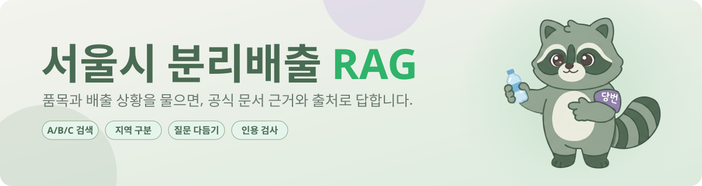
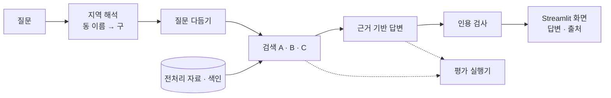
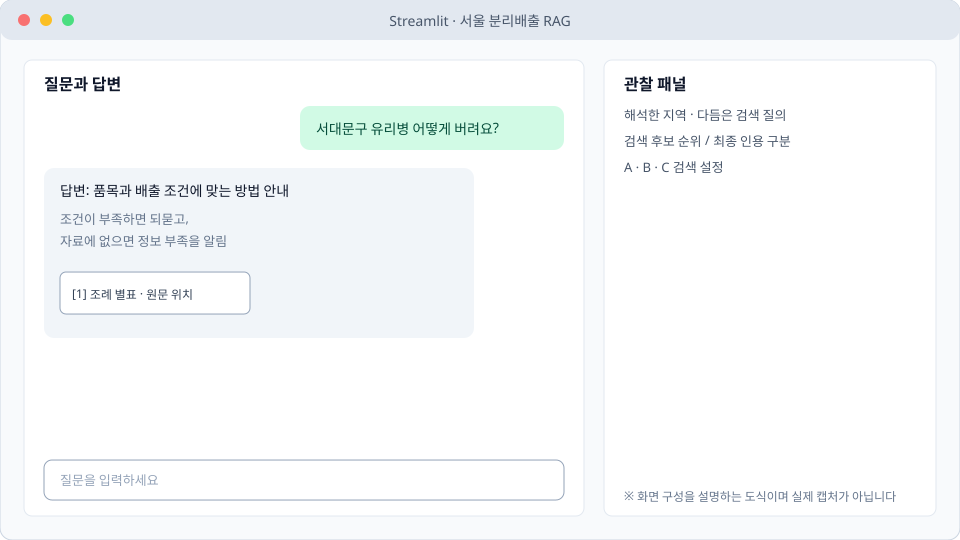

<p align="center">
  
</p>

<p align="center">
  
  
  
  
  
  
</p>

<p align="center">
  <b>서대문구·송파구 분리배출 질문에 공식 문서 근거와 출처로 답하는 RAG 기초 팀 프로젝트</b><br>
  <i>필요한 조건은 되묻고, 자료에 답이 없으면 정보 부족을 알립니다.</i>
</p>

<p align="center">
  <a href="#팀원과-역할-분담">팀 소개</a> / <a href="#협업-과정">협업 과정</a> / <a href="#프로젝트-구조">프로젝트 구조</a> / <a href="#화면-미리보기">화면 미리보기</a> / <a href="#실행-방법">실행 방법</a>
</p>

## 프로젝트 소개

서울 분리배출 RAG는 서대문구와 송파구 주민이 품목과 배출 상황을 질문하면 공식 문서에서 근거를 찾아 배출 방법과 출처를 안내하는 서비스를 만든다. 필요한 조건은 되묻고, 자료에 답이 없으면 정보 부족을 알린다.

팀의 최종 목표는 Streamlit 화면, A/B/C 검색, 동 이름 인식, 질문 다듬기다. 화면과 평가 실행기가 같은 Python RAG 함수를 호출하도록 연결한다.

팀 `dev`에는 지역 제한 A 벡터 검색기, 고정 근거 답변 검증, 공용 채팅 모델 생성·호출 함수가 있다. A/B/C 검색과 검색부터 모델 답변·인용까지의 연결, 평가 실행은 병합돼 있고, 남은 것은 화면 마무리와 제출 준비다. 팀에 병합된 기능과 답변 담당 브랜치에서 확인한 실험은 [현재 도달지점](ROADMAP.md#현재-도달지점)에서 확인한다.

| 구성 | 내용                                                                     |
| ---- | ------------------------------------------------------------------------ |
| 대상 | 서울 서대문구 · 송파구 주민                                              |
| 언어 | Python 3.13.14                                                           |
| RAG  | LangChain · rank-bm25 · 벡터 검색(A) · 하이브리드(B) · 재정렬(C)         |
| 모델 | OpenAI 임베딩(text-embedding-3-small) · 채팅 모델                        |
| 화면 | Streamlit 단일 앱                                                        |
| 평가 | pytest · Ragas · 개발·최종 문항, 실행 JSON·CSV 기록                      |
| 도구 | uv · Selenium(공식 웹 안내 수집, 선택) · Codecov · Dependabot · Gitleaks |
| 협업 | Git, GitHub, Notion                                                      |

### 현재 상태

| 구분             | 현재 상태                                                                                                                                                                                                     |
| ---------------- | ------------------------------------------------------------------------------------------------------------------------------------------------------------------------------------------------------------- |
| 문서 처리        | PR #8에서 전처리 자료를 제공했고, PR #10에서 HWP 문자 처리와 별지 분류를 보완했다. 자료 준비 명령은 같은 원문의 HTML·JSON 청크를 생성하며, 옵션을 지정하면 임베딩 색인도 만든다.                              |
| 공통 실행        | 팀 함수 연결, 지역별 근거 선택, 인용 검사, 실행 JSON 기록과 평가 실행기 구현                                                                                                                                  |
| 직접 실행        | 실제 색인의 근거 조회 CLI와 API 키 없는 합성 응답 데모 실행 가능                                                                                                                                              |
| 지역 해석과 답변 | 지역 해석기는 서울 전체 동 표로 자치구를 판별하고 충돌하면 되묻는다. 전처리 자료 답변 실험은 미리 지정한 근거로 답변과 인용을 검증한다. 벡터 단독과 BM25+벡터 앙상블의 검색 순위는 별도 실험에서 비교한다. |

현재 담당자와 변경 사항을 전달할 대상은 [4인 역할표](ROADMAP.md#업무-분담과-인계), 작업별 참고 파일은 [담당 경로](docs/architecture.md#담당-경로)에서 확인한다. 기존 공통 기반의 구현 범위와 검증 결과는 [양석호의 인계 기록](docs/handoff.md)에 있으며, 담당자별 연결 지점은 [Notion 인수인계](https://app.notion.com/p/422dc8b0e16381758494e218a97087aa)에서도 확인할 수 있다. 검색/생성 연결 함수가 준비돼 있다는 사실과 실제 서비스가 동작한다는 사실을 구분한다.

## 팀원과 역할 분담

<table>
  <tr>
    <td align="center"><a href="https://github.com/eeseuju"><br><b>이승주</b></a><br>청킹 · 화면 · 평가셋</td>
    <td align="center"><br><b>이정은</b><br>자료 검수 · 질문 다듬기</td>
    <td align="center"><br><b>이명지</b><br>검색 · 지역</td>
    <td align="center"><a href="https://github.com/kssk3"><br><b>강성수</b></a><br>답변 · 인용 · 품질 추적</td>
  </tr>
</table>

| 이름   | 주요 담당                                                                                         |
| ------ | ------------------------------------------------------------------------------------------------- |
| 이승주 | 원문 데이터에 맞춘 청킹 규칙 개선 · Streamlit 화면·관찰 패널 · 최종 평가셋 관리              |
| 이정은 | 수집·정제 자료와 원문 검수 · 품목 별칭 · 질문 다듬기 프롬프트 개선                                |
| 이명지 | 검색 기반 · 지역 해석 · A/B/C 검색 · 검색 지표 (검색 시스템 v2 목표: OpenSearch 도입) |
| 강성수 | 근거 기반 답변 · 재질문·근거 부족·오류 처리 · 인용 검증 · 개발 문항과 품질 추적 (Ragas·Langfuse)  |

_※ 변경하면 누구에게 무엇을 전달하는지는 [업무 분담과 인계](ROADMAP.md#업무-분담과-인계)에 있다. 공통 기반은 양석호가 인계했다._

## 협업 과정

통합 기준 브랜치는 `dev`다. 작업 브랜치는 `feature/<작성자>/<작업명>`으로 만들고, 검증 후 `dev`를 대상으로 PR을 연다.

```text
담당 기능 구현 → 작업 브랜치에 커밋 → push → Pull Request → 리뷰 → dev에 병합
```

- 공통 기반을 바꿀 때는 해당 기능 담당자가 변경을 주도하고, 결과를 받는 담당자와 입출력을 확인한다.
- 합성 검증 자료는 `tests/fixtures/`에 있으며 최종 평가셋은 `eval/test.json`, 평가 결과는 `results/`와 `report.md`에 있다.

## 프로젝트 구조

```text
best-driver-rag-project/
├─ src/          # 공통 실행 기반과 담당별 Python 모듈
├─ configs/ prompts/ .streamlit/   # 공통 설정, 프롬프트, 화면 설정
├─ scripts/      # 수집, 색인과 평가 실행 진입점
├─ data/         # 수집 원문, 정제 자료와 색인
├─ eval/         # 개발·최종 문항과 채점용 정답 근거 (준비 상태는 eval/README.md)
├─ results/      # 실행 원본, 평가와 비교 결과
├─ tests/        # 단위 검사, 연동 검사와 작은 검증 자료
├─ docs/         # 구조·인계·기준 문서
└─ app.py        # Streamlit 화면
```

질문이 답변이 되기까지의 흐름은 이렇게 연결된다.



_※ 상세 파일 목록, 담당 경로와 연결 원칙은 [구조와 책임](docs/architecture.md)에, 파일별 구현 항목은 [Notion 구조 문서](https://app.notion.com/p/422dc8b0e1638150b62acfe703074f30?pvs=204)에 있다. 폴더의 `.gitkeep`은 빈 작업 위치를 Git에 보존하기 위한 파일이다._

## 화면 미리보기

<p align="center">
  
</p>

<p align="center">
  <sub>화면 구성을 설명하는 도식입니다. 실제 캡처는 화면이 확정되면 교체합니다.</sub>
</p>

## 실행 방법

### 개발 환경

이 README가 있는 저장소 루트에서 실행한다. Python `3.13.14`, uv `0.13.9` 이상과 `uv.lock`을 사용한다. 로컬 변경의 완료와 원격 브랜치 반영은 별개다.

```sh
uv sync --locked
uv run --locked python --version
uv run --locked python -m pytest --version
```

로컬 uv가 요구 버전보다 낮으면 전역 설치를 바꾸지 않고 `uv tool run --from uv==0.13.9 uv sync --locked`로 같은 환경을 준비할 수 있다. 첫 설치는 Python 배포 서버와 PyPI 연결이 필요하다. 이 방식으로 설치했다면 실행도 `uv tool run --from uv==0.13.9 uv run --locked python --version`처럼 같은 uv 버전을 사용한다. 기존 Python 3.15 가상환경도 동기화하면 `.python-version`에 맞는 3.13.14 환경으로 다시 생성한다.

루트 의존성 파일은 Streamlit을 포함한 공용 Python 환경을 관리한다. 공식 웹 안내는 [Selenium 선택 그룹으로 수집한다](docs/official-guide-collection.md). Langfuse 등 새 패키지는 해당 기능을 처음 연결하는 PR에서 의존성과 잠금 파일을 함께 갱신한다. 기존 FastAPI 의존성이 남아 있어도 별도 HTTP 서버 구현을 요구하지 않는다.

Streamlit 화면은 데모 색인을 먼저 만든 뒤 실행한다. 데모 색인은 합성 문서만 쓰며 외부 호출이 없다.

```bash
uv run --locked python -m scripts.index --documents tests/fixtures/handoff_documents.json --output data/indexes/demo.json --demo --dimensions 128
uv run --locked streamlit run app.py
```

### 실제 자료 준비와 근거 조회

저장소의 전처리 인계 자료에는 [PR #8의 전처리 결과](https://github.com/kssk3/best-driver-rag-project/pull/8)와 [PR #10의 수정 사항](https://github.com/kssk3/best-driver-rag-project/pull/10)이 반영돼 있다. 저장소 루트에서 아래 명령을 실행하고, 출력 경로에는 아직 없는 폴더를 지정한다.

```sh
uv run --locked python -m scripts.prepare_data --bundle data/handoff/jungeun/ordinance-handoff-2026-11-24 --version v1 --output-dir data/processed/ordinance-v2-prepared
```

이 명령은 외부 호출 없이 공용 문서와 HTML/JSON 청크를 만든다. 별도로 받은 v2 인계 ZIP도 `--bundle "받은 ZIP의 실제 경로"`으로 지정할 수 있다. `--version v1`은 원문 버전이며 인계 파일명의 `v2`와는 별개다.

실제 색인까지 만들려면 `OPENAI_API_KEY` 환경변수를 준비한 뒤 별도 출력 폴더로 실행한다. 기존 키 파일은 `--api-key-file`로 명시할 수도 있으며 `.env`는 자동 로드하지 않는다.

```sh
uv run --locked python -m scripts.prepare_data --bundle data/handoff/jungeun/ordinance-handoff-2026-11-24 --version v1 --output-dir data/processed/ordinance-v2-openai-small --openai-model text-embedding-3-small
```

검토한 인계 자료는 Git에 포함돼 있다. 새로 생성한 청크, 색인과 실행 결과는 Git 제외 경로에 저장하며 개인 보관 ZIP과 키 파일도 커밋하지 않는다.

현재 로컬에서 검증한 실제 색인으로 반복 질문하려면 다음과 같이 실행한다. 새 체크아웃에서는 같은 출력 위치로 색인을 먼저 준비해야 한다.

```sh
uv run --locked python -m scripts.search_index --index data/processed/ordinance-v2-openai-small/index-html.json --index data/processed/ordinance-v2-openai-small/index-json.json --district 송파구
```

`--question "질문"`을 지정하면 한 번 조회하고, 생략하면 질문을 반복 입력한다. `/종료`로 끝낸다. 이 명령은 지역을 제한한 코사인 유사도 검색 결과를 출력한다. 관련성 하한이 없어 `안녕`에도 무관한 결과가 나올 수 있고, 실제 질문에서 관련 별표가 상위 결과에 빠진 사례도 있다. 팀 파이프라인용 [A 벡터 검색기](src/retrieval/search.py)는 별도 진입점이다. HTML·JSON 비교의 범위와 재실행 방법은 [전처리 자료 인계 기록](docs/handoff.md#실제-전처리-자료-연결)에 있다.

### 팀 색인과 리라이트 비교

팀 색인(JSON) 경로와 답변 모델을 [A 검색 실행 설정](configs/team-a-rewrite-chat.json)에 지정한다. 색인과 모델 키를 준비한 환경에서 다음 명령을 실행하면 Streamlit에 **실행** 모드가 표시된다. `RAG_CHAT_SETTINGS`의 상대 경로는 저장소 루트 기준이다. 설정 파일의 `pipeline.rewrite_enabled`를 바꿔 저장하면 다음 질문부터 바뀐 값으로 실행한다. 같은 경로의 팀 색인이나 활성 품목 사전을 교체해도 다음 질문에서 새 파일을 읽는다. 런타임을 가져오는 중에 파일이 바뀌었다는 메시지가 나오면 교체를 마친 뒤 다시 질문한다.

```sh
RAG_CHAT_SETTINGS=configs/team-a-rewrite-chat.json \
  uv run --locked --env-file .env streamlit run app.py
```

실행 설정을 지정하지 않으면 [C 채팅 설정](configs/team-c-rewrite-chat.json)으로 실행하는 런처를 쓸 수 있다. 로컬 `.env`에 `OPENAI_API_KEY`를 둔다. 기본 팀 색인이 없으면 런처가 OpenAI 임베딩으로 만든다. Streamlit을 시작하기 전에 기존 색인과 새로 만든 기본 색인 모두의 청크 지문을 [JSON 기준선](results/chunking/chunk_stats.csv)과 대조한다. 설정 파일이 다른 경로를 가리키면 그 색인은 직접 준비한다.

```sh
uv run --locked --env-file .env python -m scripts.run_chat
```

A 검색의 OFF/ON을 같은 질문·색인·검색 옵션·답변 모델로 한 번에 실행한다. 출력 경로에는 새 이름을 사용한다.

```sh
uv run --locked --env-file .env python -m scripts.evaluate \
  --cases eval/dev.json --settings configs/team-a-rewrite-chat.json \
  --factory src.evaluation.answer_experiments.answer_evaluation_runtimes:create_a_rewrite_comparison \
  --output-dir results/local/catalog-rewrite-comparison
```

기본 A/B/C 평가와 A 리라이트 비교는 별도의 출력 디렉터리에 기록한다. 기본 A 평균에는 기본 평가의 A 실행만 사용하고, 리라이트 효과는 별도의 A OFF/ON 결과로 비교한다.

ON은 품목 사전 규칙으로 검색 질의를 보강한다. `evaluation.json`에는 원질문, 실제 검색 질의, 해석된 구·동, 리라이트 상태, 색인과 사전 버전이 들어간다. `runs.csv`와 `candidates.csv`에서 구성별 후보 청크와 허용 근거의 검색 순위를 비교한다.

### 자동 데모와 검증

```sh
uv run --locked python -m scripts.demo
```

API 키 없이 합성 문서 3개로 색인부터 답변, 지역 재질문, 근거 부족과 실행 기록 저장까지 확인한다. 실행할 때마다 `results/local/handoff-demo-<실행 식별자>/`에 색인과 결과 JSON, 문항·실행·검색 후보 CSV를 만든다. 해시 임베딩과 본문 인용을 사용하는 연결 검사이며 실제 분리배출 안내나 검색 품질 평가 결과가 아니다.

#### dev 반영 후 답변과 지역 해석 검증

팀 `dev`에서 지역 해석, 고정 근거 답변, 검색 비교를 확인하는 명령이다. Python 3.13.14와 uv 0.13.9 이상을 사용한다. 아래 테스트와 검색 비교에는 모델 API 키가 필요 없다. 실제 모델을 호출하는 개발 문항 실험은 [평가셋 실행 안내](eval/README.md)를 따른다.

```sh
git switch dev
git pull --ff-only origin dev
uv sync --locked
uv run --locked python -m pytest -q tests/unit/generation tests/unit/answer_experiments tests/unit/test_regions.py
uv run --locked python -m src.evaluation.answer_experiments.evidence_retrieval_benchmark --output-dir results/local/evidence-team-check --repeats 10
```

검색 비교를 다시 실행할 때마다 새 출력 폴더를 지정한다. 전체 테스트 명령은 `uv run --locked python -m pytest -q tests`다.

[전처리 자료 질문별 결과표](results/testData.md)에서 세 사례의 검색 순위, 답변, 인용을 CSV 원본과 대조할 수 있다. 동 이름에서 추론한 구를 검색기와 생성기가 각각 어떻게 사용하는지는 [지역 해석과 답변 생성 연결](docs/TEAM-SETUP.md#전처리-자료-지역-해석과-답변-생성-연결)에 정리했다.

입력 자료 규격, 색인/평가 명령과 팀 함수 연결 예시는 [인계 문서](docs/handoff.md)에 있다. `sources.json`은 문서 목록과 첨부 관계를 읽는 별도 입력이며 전처리 묶음 대신 넣지 않는다. OpenAI 임베딩 환경변수는 [.env.example](.env.example)을 참고한다.

## 팀 공통 문서

- [문제와 평가 기준](docs/problem.md): 지원 범위, 평가 분리와 완료 기준
- [공동 진행 단계](ROADMAP.md): 7단계와 병렬 작업 흐름
- [개발 환경과 연결 기준](docs/TEAM-SETUP.md): 공용 규격과 인계 방식
- [검사와 의존성 관리](docs/CI-AND-DEPENDENCIES.md): pytest, Codecov, Dependabot과 Gitleaks
- [출처 목록 로더](docs/source-manifest-loader.md): `sources.json` 필드와 첨부 관계 읽기
- [공통 기반 최소 인계본](docs/handoff.md): 입력 규격, API, 실행 명령, 현재 한계와 검증 결과

통합 기준 브랜치는 `dev`다. 작업 브랜치는 `feature/<작성자>/<작업명>`으로 만들고, 검증 후 `dev`를 대상으로 PR을 연다. 합성 검증 자료는 `tests/fixtures/`에 있으며 최종 평가셋은 `eval/test.json`, 평가 결과는 `results/`와 `report.md`에 있다.
