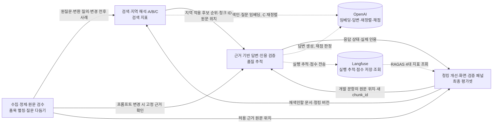
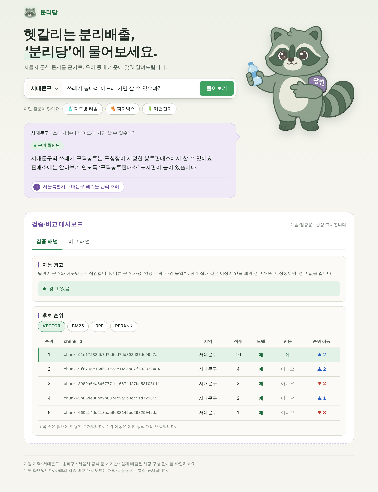

<p align="center">
  
</p>

<p align="center">
  
  
  
  
  
  
</p>

<p align="center">
  <b>분리당(分離當)</b> · TEAM <b>너구리 여객</b><br>
  <i>"오늘의 분리배출 당번"</i><br>
  <b>서대문구·송파구 분리배출 질문에 공식 문서 근거와 출처로 답하는 RAG 기초 팀 프로젝트</b><br>
  <i>필요한 조건은 되묻고, 자료에 답이 없으면 정보 부족을 알립니다.</i>
</p>

<p align="center">
  <a href="#프로젝트-소개">소개</a> / <a href="#팀원과-역할-분담">팀</a> / <a href="#프로젝트-구조">구조</a> / <a href="#화면-미리보기">화면</a> / <a href="#실행-방법">실행</a> / <a href="#평가-결과">평가</a> / <a href="#공통-문서">문서</a>
</p>

<br>

## 프로젝트 소개

서대문구와 송파구 주민이 품목과 배출 상황을 질문하면 공식 문서에서 근거를 찾아 배출 방법과 출처를 안내한다. 동 이름으로 구를 판별하고, 구가 충돌하거나 조건이 부족하면 되묻고, 근거가 없으면 정보 부족으로 답한다. Streamlit 화면과 평가 실행기는 같은 Python RAG 함수를 호출한다. A/B/C 검색, 검색부터 답변·인용까지의 연결, 평가 실행기와 Langfuse 점수 연결까지 구현되어 있다.

| 구성 | 내용                                                                                           |
| ---- | ---------------------------------------------------------------------------------------------- |
| 검색 | 지역 제한 벡터(A) · BM25+벡터 융합(B) · LLM 재정렬(C), 선택적 질문 다듬기                      |
| 답변 | 근거 기반 모델 답변 · 인용 검증 · 재질문 · 근거 부족 · 오류 안내                               |
| 모델 | OpenAI 임베딩(text-embedding-3-small) · 채팅 모델                                              |
| 평가 | pytest · Ragas · Langfuse, 개발 10·최종 20문항, 실행 JSON·CSV 기록                             |
| 도구 | Python 3.13.14 · uv · LangChain · rank-bm25 · Selenium(선택) · Codecov · Dependabot · Gitleaks |

<br>

## 팀원과 역할 분담

<table>
  <tr>
    <td align="center" width="20%"><a href="https://github.com/Cocode96"><br><b>양석호</b></a><br><sub>공통 기반 및 규격 인계<br>런타임 · 실행 기록</sub></td>
    <td align="center" width="20%"><a href="https://github.com/kssk3"><br><b>강성수</b></a><br><sub>답변 · 인용 · 품질 추적<br>재질문 · Ragas · Langfuse</sub></td>
    <td align="center" width="20%"><a href="https://github.com/axfehlerlee"><br><b>이정은</b></a><br><sub>자료 검수 · 질문 다듬기<br>품목 별칭 · 프롬프트 개선</sub></td>
    <td align="center" width="20%"><a href="https://github.com/mjlee0914"><br><b>이명지</b></a><br><sub>검색 · 지역 구분<br>A/B/C 검색 · 검색 지표</sub></td>
    <td align="center" width="20%"><a href="https://github.com/eeseuju"><br><b>이승주</b></a><br><sub>청킹 · 평가셋<br>챗봇 · 관찰 패널</sub></td>
  </tr>
</table>

<br>

### 협업 규칙

통합 기준 브랜치는 `dev`, 작업 브랜치는 `feature/<작성자>/<작업명>`이다. 검증 후 `dev`를 대상으로 PR을 열고 리뷰를 거쳐 병합한다. 공통 기반은 해당 기능 담당자가 변경을 주도하고, 결과를 받는 담당자와 입출력을 확인한다. 큰 버전 업데이트가 완료되면 `main`에 병합한다.

<br>

## 프로젝트 구조

```text
best-driver-rag-project/
├─ src/          # 공통 실행 기반과 담당별 Python 모듈
├─ configs/ prompts/ .streamlit/   # 공통 설정, 프롬프트, 화면 설정
├─ scripts/      # 수집, 색인과 평가 실행 진입점
├─ data/         # 수집 원문, 정제 자료와 색인
├─ eval/         # 개발·최종 문항과 채점용 정답 근거
├─ results/      # 실행 원본, 평가와 비교 결과
├─ tests/        # 단위 검사, 연동 검사와 작은 검증 자료
├─ docs/         # 구조·인계·기준 문서
└─ app.py        # Streamlit 화면
```



_※ 상세 파일 목록과 연결 원칙은 [구조와 책임](docs/architecture.md), 파일별 구현 항목은 [Notion 구조 문서](https://app.notion.com/p/422dc8b0e1638150b62acfe703074f30?pvs=204)에서 확인할 수 있습니다._

<br>

## 화면 미리보기

<p align="center">
  
</p>

<p align="center">
  <sub><i>랜딩 화면과 검증·비교 대시보드 목업입니다.<br>데모 화면이라 답변과 후보 점수는 화면 확인용이며 평가 결과가 아닙니다.</i></sub>
</p>

<br>

## 실행 방법

저장소 루트에서 실행한다. Python `3.13.14`, uv `0.13.9` 이상과 `uv.lock`을 사용한다.

```sh
uv sync --locked
```

### 화면 실행: C 검색기 (권장)

로컬 `.env`에 `OPENAI_API_KEY`를 두고 런처를 실행한다. 기본 팀 색인이 없으면 OpenAI 임베딩으로 만들고, 시작 전에 청크 지문을 [JSON 기준선](results/chunking/chunk_stats.csv)과 대조한다.

```sh
uv run --locked --env-file .env python -m scripts.run_chat
```

화면은 실제 팀 색인과 OpenAI 키가 있어야 답한다. 실행 설정(`RAG_CHAT_SETTINGS`) 없이 `streamlit run app.py`만 실행하면 안내 오류가 나오고 질문은 받지 않는다. 합성 데모는 화면에서 제거했다.

### API 키 없이 연결 검사

```sh
uv run --locked python -m scripts.demo
```

합성 문서만 쓰고 외부 호출이 없다. 색인부터 답변, 지역 재질문, 근거 부족, 실행 기록 저장까지 확인한다. 해시 임베딩을 쓰는 연결 검사이며 실제 안내나 검색 품질 결과가 아니다.

<details>
<summary>&nbsp;&nbsp;📦&nbsp;uv 환경 준비 · 전처리 자료로 청크 & 색인 만들기 · 색인에서 근거 조회하기</summary>

로컬 uv가 요구 버전보다 낮으면 `uv tool run --from uv==0.13.9 uv sync --locked`로 같은 환경을 준비하고, 이후 실행도 같은 uv 버전을 쓴다. 첫 설치는 Python 배포 서버와 PyPI 연결이 필요하다. 공식 웹 안내는 [Selenium 선택 그룹](docs/official-guide-collection.md)으로 수집한다.

전처리 인계 자료([PR #8](https://github.com/kssk3/best-driver-rag-project/pull/8), [PR #10](https://github.com/kssk3/best-driver-rag-project/pull/10))로 HTML·JSON 청크를 만든다. 출력 경로에는 아직 없는 폴더를 지정한다. `--version v1`은 원문 버전이며 인계 파일명의 `v2`와 별개다.

```sh
uv run --locked python -m scripts.prepare_data --bundle data/handoff/jungeun/ordinance-handoff-2026-11-24 --version v1 --output-dir data/processed/ordinance-v2-prepared
```

색인까지 만들려면 `OPENAI_API_KEY`를 준비하고 `--openai-model text-embedding-3-small`을 더해 별도 폴더로 실행한다(`.env`는 자동 로드하지 않고, 키 파일은 `--api-key-file`로 지정한다). 생성한 청크·색인·실행 결과와 개인 키 파일은 커밋하지 않는다. 만든 색인으로 반복 질문하려면 다음과 같이 실행한다.

```sh
uv run --locked python -m scripts.search_index --index data/processed/ordinance-v2-openai-small/index-html.json --index data/processed/ordinance-v2-openai-small/index-json.json --district 송파구
```

`--question "질문"`은 한 번 조회하고, 생략하면 `/종료`까지 반복 입력한다. 지역을 제한한 코사인 유사도 결과만 출력하며 관련성 하한이 없어 무관한 질문에도 결과가 나온다. HTML·JSON 비교 범위는 [전처리 자료 인계 기록](docs/handoff.md#실제-전처리-자료-연결)에 있다.

</details>

<details>
<summary>&nbsp;&nbsp;🖥️&nbsp;화면 "실행" 모드 설정 · 질문 다듬기 OFF/ON 비교 실행</summary>

[A 검색 실행 설정](configs/team-a-rewrite-chat.json)에 팀 색인 경로와 답변 모델을 지정하면 Streamlit에 **실행** 모드가 표시된다. `pipeline.rewrite_enabled`를 바꿔 저장하거나 색인·품목 사전을 교체하면 다음 질문부터 새 값을 읽는다.

```sh
RAG_CHAT_SETTINGS=configs/team-a-rewrite-chat.json \
  uv run --locked --env-file .env streamlit run app.py
```

같은 질문·색인·옵션·모델로 A의 OFF/ON을 한 번에 비교한다. 출력 경로에는 새 이름을 쓴다. `evaluation.json`에 원질문, 실제 검색 질의, 해석된 구·동, 리라이트 상태, 색인·사전 버전이 남고, `runs.csv`와 `candidates.csv`에서 구성별 후보 순위를 비교한다.

```sh
uv run --locked --env-file .env python -m scripts.evaluate \
  --cases eval/dev.json --settings configs/team-a-rewrite-chat.json \
  --factory src.evaluation.answer_experiments.answer_evaluation_runtimes:create_a_rewrite_comparison \
  --output-dir results/local/catalog-rewrite-comparison
```

</details>

<details>
<summary>&nbsp;&nbsp;🧪&nbsp;단위 테스트 및 벡터 vs. BM25 & 벡터 검색 순위 비교 (API 키 불필요)</summary>

```sh
uv run --locked python -m pytest -q tests/unit/generation tests/unit/answer_experiments tests/unit/test_regions.py
uv run --locked python -m src.evaluation.answer_experiments.evidence_retrieval_benchmark --output-dir results/local/evidence-team-check --repeats 10
```

위 테스트와 검색 비교에는 API 키가 필요 없고, 비교는 실행마다 새 출력 폴더를 지정한다. 전체 테스트는 `uv run --locked python -m pytest -q tests`다. 실제 모델을 호출하는 실험은 [평가셋 안내](eval/README.md)를 따른다. 세 사례의 순위·답변·인용은 [전처리 자료 결과표](results/testData.md)에서 CSV 원본과 대조할 수 있고, 지역 해석과 답변 생성의 연결은 [TEAM-SETUP](docs/TEAM-SETUP.md#전처리-자료-지역-해석과-답변-생성-연결)에 있다. 입력 규격과 팀 함수 연결 예시는 [인계 문서](docs/handoff.md), 환경변수는 [.env.example](.env.example)을 본다.

</details>

<br>

## 평가 결과

- **문항**
  - [개발 10](eval/dev.json) · [최종 20](eval/test.json)
  - 채점용 정답 근거와 작성 규칙은 [평가셋 안내](eval/README.md)
- **실행**
  - A/B/C 각 20건(질문 다듬기 OFF)과 C/질문 다듬기 20건
  - 저장된 실행으로 Faithfulness·Answer Relevancy·ID 정밀도/재현율을 사후 계산한다.
- **결과**
  - [비교 보고서](report.md)와 [실행 기록 안내](results/README.md)
  - 재현 명령은 [재현 문서](docs/reproduction.md)
  - 실행 뒤 확인된 문항 결함은 [정오표](eval/errata/README.md)에 따로 두었다. (공식 최종셋은 그대로)

<br>

## 공통 문서

| #   | 문서                                              | 내용                                                |
| --- | ------------------------------------------------- | --------------------------------------------------- |
| 01  | [문제와 평가 기준](docs/problem.md)               | 지원 범위 · 평가 분리 · 완료 기준                   |
| 02  | [진행 계획](ROADMAP.md)                           | 7단계 · 병렬 작업 흐름 · 역할과 인계                |
| 03  | [개발 환경과 연결 기준](docs/TEAM-SETUP.md)       | 공용 규격과 인계 방식                               |
| 04  | [출처 목록 로더](docs/source-manifest-loader.md)  | `sources.json` 필드와 첨부 관계                     |
| 05  | [공통 기반 인계본](docs/handoff.md)               | 입력 규격 · API · 실행 명령 · 현재 한계와 검증 결과 |
| 06  | [검사와 의존성 관리](docs/CI-AND-DEPENDENCIES.md) | pytest · Codecov · Dependabot · Gitleaks            |
| 07  | [문서 목록](docs/documents.md)                    | 색인에 쓰는 자치법규와 별표 및 별지 목록            |
| 08  | [데이터 이용과 보안 점검](docs/data-usage.md)     | 이용 조건 · 외부 모델 전송 · 비밀정보 및 로그 점검  |
| 09  | [시연 질문 목록](docs/demo-script.md)             | 발표와 영상에 쓸 질문과 기대 응답                   |
| 10  | [팀 기여 기록](contributions.md)                  | 담당별 PR · 리뷰 · 커밋 근거                        |
