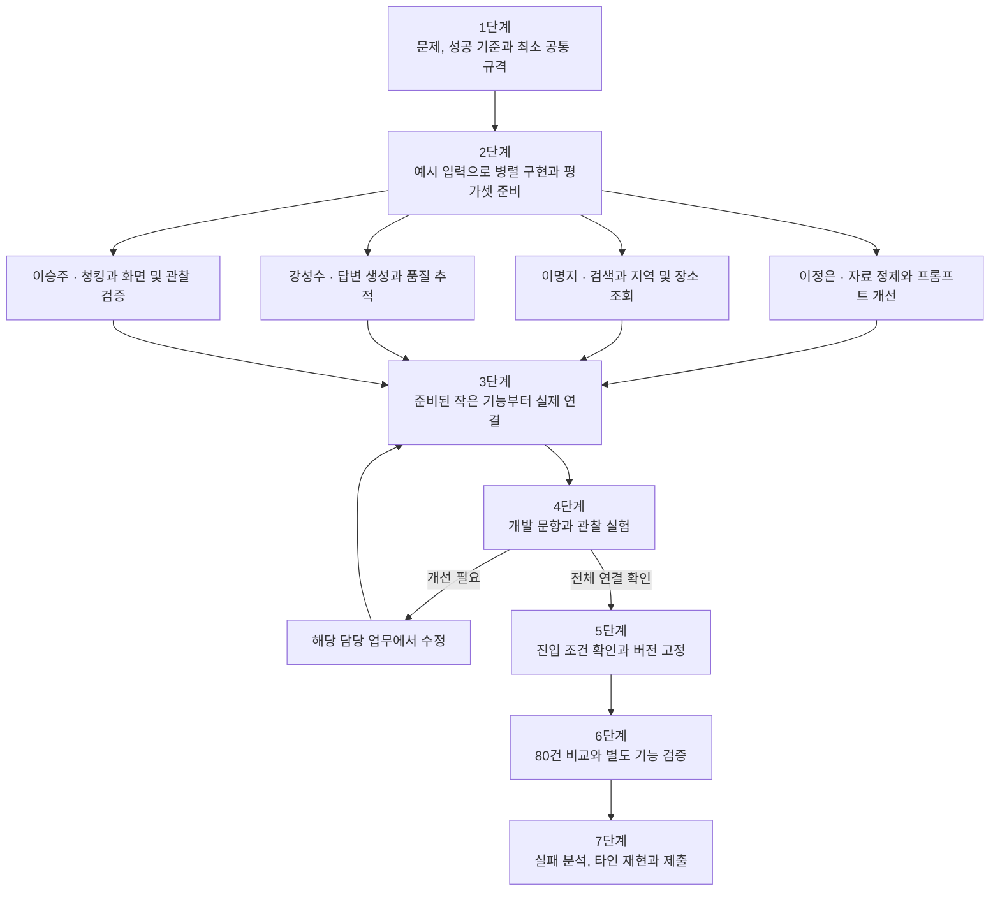

# 서울 분리배출 RAG 프로젝트 진행 계획

서대문구와 송파구 주민이 공식 문서에 근거한 분리배출 안내와 수거 장소를 확인할 수 있는 Streamlit 서비스를 만든다. 이 로드맵에서 담당자, 연결 시점, 팀 `dev`에 반영된 기능을 확인한다.

## 하위 에이전트에 작업을 맡길 때

1. [역할표](#업무-분담과-인계)에서 담당자와 결과를 받을 사람을 확인하고, [담당 경로](docs/architecture.md#담당-경로)에서 작업 모듈을 찾는다. 내부 구조는 담당자가 정하고, 공용 입출력·의존성·저장 방식은 사용하는 담당자와 맞춘다.
2. 기대 결과와 [제품·평가 기준](docs/problem.md)을 함께 전달한다. 공용 인터페이스를 다룰 때는 [작업별 연결 기준](docs/TEAM-SETUP.md#작업별-연결-기준), 해당 호출부, 대상 커밋에서 이를 검증하는 테스트를 지정한다.
3. 팀 공통 상태는 병합된 `dev`를 기준으로 확인한다. 작업 브랜치나 PR을 다룰 때는 커밋과 검증 범위를 함께 적고, 구현과 목표 사이에 남은 일은 담당자에게 전달한다.

## 현재 도달지점

팀 기능이 병합되면 아래 표의 해당 항목과 기준 커밋을 갱신한다. 문항과 실행 명령은 [평가셋 안내](eval/README.md), 당시 검증 수치와 결과 해석은 [실행 기록 안내](results/README.md)에서 관리한다.

Implementation snapshot for November 26, 2026, at local `dev` commit [`a2b3db93`](https://github.com/kssk3/best-driver-rag-project/commit/a2b3db93c0b6621c18fef6353615137de52436a5).

| Area | Available on this revision | Remaining work |
| --- | --- | --- |
| Index and retrieval | The JSON team index supports district-filtered vector retrieval (A), vector and BM25 rank fusion (B), and reranking of the fused candidates (C). The [launcher](scripts/run_chat.py) checks the default index against the [chunk baseline](results/chunking/chunk_stats.csv). | Compare retrieval quality on reviewed cases. OpenSearch and the bge-m3 comparison remain project goals. |
| Chat and location | Streamlit runs A or C with a model answer and optional catalog rewriting. The resolver uses the Seoul dong table and handles district conflicts through clarification. The place parser accepts supplied getSpot responses. | Live place lookup and a user-facing map remain delivery goals. |
| Evaluation | The [development set](eval/dev.json) has 10 cases and the [final set](eval/test.json) has 20 (AI drafts, confirmed by the team before the run). A/B/C with rewriting off (60 runs) and C with rewriting (20 runs) were each run once; the [report](report.md) gives Hit@5, answer correctness, citation validity, timing and a failure analysis. Saved runs also support Faithfulness scoring and [Langfuse score uploads](results/README.md). | Per-case source-evidence review record, an optional table-row search improvement (kept as an experiment, see the report), and the submission tag. |

**답변 담당 작업 브랜치**에서 두 개발 문항을 팀 A 검색기와 답변 모델로 각각 실행했다. 서대문구 색상표의 허용 근거는 검색 1위였고 모델은 1위를 인용했다. 송파구 대형폐기물 문항의 허용 근거는 3위였고 모델은 3위와 1위를 인용했다. 송파구 정답표의 다음 작업은 공식 원문 대조다. 당시 `git_base`는 `49db656`이었고 실행에는 로컬 변경이 포함됐다. [커밋 `e0a31d2`](https://github.com/kssk3/best-driver-rag-project/commit/e0a31d2a6a4ddeef36f493b5eed853838a4c6bb2)의 개발 문항 파일과 팀 A 런타임 생성 코드의 SHA-256은 실행 기록에 저장된 값과 각각 일치한다. [개발셋과 재현 방법](eval/README.md) · [두 문항의 실행 기록](results/team-a/2026-11-25T064832Z/runs.csv)

HTML·JSON 형식 비교는 같은 원문 `text`를 사용한다. JSON의 `search_text` 정규화 효과, 두 형식의 검색 품질 우열, bge-m3와의 비교는 아직 측정하지 않았다.

## 업무 분담과 인계

현재 팀은 이승주·이정은·이명지·강성수 4인으로 운영한다. 공통 기반을 변경할 때는 해당 기능 담당자가 변경을 주도하고, 그 결과를 받는 담당자와 입출력을 확인한다.

| 담당자 | 현재 맡은 작업 | 변경하면 누구에게 무엇을 전달하는가 |
| --- | --- | --- |
| 이승주 | 원문 데이터에 맞춰 청킹 규칙을 개선하고 Streamlit 화면·지도·관찰 패널을 구현한다. 최종 평가셋을 관리한다. | 청킹을 바꾸면 이명지에게 재색인할 문서와 청킹 버전을, 강성수에게 개발 문항의 원문 위치와 새 `chunk_id`를 전달한다. 화면에서는 검색 후보와 최종 인용을 구분한다. |
| 이정은 | 수집·정제 자료와 원문 검수를 이어가고, 품목 별칭과 질문 다듬기 프롬프트를 개선한다. | 이명지에게 원질문·변환 질의·보존할 조건과 변경 전후 사례를 전달한다. 답변 생성용 프롬프트도 변경할 경우 강성수와 고정 근거로 응답 상태와 인용을 확인한다. |
| 이명지 | 검색 기반, 지역 해석, A/B/C 검색, 장소 조회와 검색 지표를 담당한다. 검색 시스템 v2의 목표는 OpenSearch 도입이다. | 이승주의 청크를 색인하고 강성수에게 지역을 적용한 후보 순위·청크 ID·원문 위치를 전달한다. 같은 질문으로 변경 전후 순위와 Hit@5를 비교한다. |
| 강성수 | 근거 기반 답변, 재질문·근거 부족·오류 처리, 인용 검증, 개발 문항과 품질 추적을 담당한다. Ragas 진술 판정과 Langfuse 실행 기록을 대조한다. | 이승주에게 화면에 표시할 응답 상태와 인용을 제공한다. 개발 문항에서 근거가 검색되지 않은 경우는 이명지와, 근거가 있어도 잘못 답한 경우는 답변 초안과 인용을 확인한다. |

**같이 확인할 예시.** 전처리 자료 공동주택 수거용기 색상표가 바뀌면 이승주가 표의 품목·색상·적용 조건과 원문 위치를 보존해 청크를 만든다. 이명지는 같은 질문에서 새 청크의 순위를 확인하고, 강성수는 유리병과 캔의 색을 바꿔 물어도 올바른 답변과 인용이 나오는지 확인한다. 이정은은 같은 색인을 사용해 질문 다듬기 전후를 비교한다. 튜닝에는 개발 문항을 사용하고, 위례동 일정 충돌은 별도 관찰 사례로 유지한다. [전처리 자료 비교 결과](results/testData.md) · [평가셋 관리](eval/README.md)

**공통 기반 인계.** 양석호가 공용 계약, 로더, 청킹·색인, 런타임, 실행 기록과 평가 실행기를 인계했다. 당시 구현과 검증 결과는 [11월 24일 인계 기록](docs/handoff.md), 새 작업의 담당자와 연결 기준은 [작업 배정 안내](#하위-에이전트에-작업을-맡길-때)에서 확인한다.

개발 실험에서는 이명지가 제공한 후보·허용 청크 ID로 검색 정밀도와 재현율을 확인하고, 강성수가 저장 답변의 관련성 및 Faithfulness와 같은 실행에서 대조한다. 보류 안내를 평가한 점수는 응답 상태와 함께 해석한다. [실험 점수 연결 절차](results/README.md#기존-실행에-팀-실험-점수-연결)

## 팀 공통 7단계

발제의 5일 40시간 안에서 세부 일정은 팀이 정한다. **2~4단계는 겹쳐 진행하고, 담당 기능 전체가 완성되기 전에도 준비된 작은 결과부터 연결한다.**

| 단계 | 진행할 작업 | 함께 확인할 완료 조건 |
| --- | --- | --- |
| 1단계 | 문제, 성공 기준과 최소 공통 규격 합의 | 두 구의 질문과 제외 범위, 오답 영향, 품질/시간/비용 우선순위와 사전 목표, 채점 기준, 문서/응답/장소 예시를 준비한다. 자료 이용 조건과 비밀정보 관리도 확인한다. |
| 2단계 | 네 담당 영역의 병렬 구현과 평가셋 준비 | 예시 입력으로 각 영역을 독립 실행한다. 개발 10문항과 최종 20문항을 처음부터 분리하고 원문 근거를 확인한다. |
| 3단계 | 준비된 기능부터 실제 데이터로 연결 | 지역 제한을 적용한 A 검색부터 답변과 실제 출처까지 연결한다. B/C, 동 이름 해석, 질문 다듬기와 지도를 준비되는 대로 합친다. 같은 요청에서 후보, 실제 입력, 답변, 인용과 오류를 추적한다. |
| 4단계 | 개발 문항과 관찰 실험으로 반복 개선 | 개발 10문항과 별도 관찰 질문으로 실패를 찾는다. 해당 담당자가 수정하고 같은 개발 사례로 전후 결과를 비교한다. |
| 5단계 | 최종 평가 진입 조건 확인과 버전 고정 | 문서 기반 답변 가능 질문 25개와 혼동 문서 최소 2개, 출처 추적, 리라이트 동작, 지역 인식과 실제 지도를 확인한다. 평가 입력 분리를 점검하고 데이터와 실행 조건을 고정한다. |
| 6단계 | 최종 80건 비교와 별도 기능 검증 | A/B/C 각 20건은 리라이트 OFF, C+리라이트 20건은 ON으로 실행한다. 원본과 지표를 보존하고 지도와 지역 인식은 별도 사례로 검증한다. |
| 7단계 | 실패 분석, 타인 재현과 제출본 완성 | 결과로 최종 구성을 선택하고 한계를 설명한다. 다른 팀원의 재실행, 개인별 기여와 리뷰, 비교 보고서와 시연을 완성한다. |

1단계의 실행 환경 확인에는 작은 문서 1개, 생성과 임베딩의 실제 호출 각 1건, BM25와 벡터 검색의 개별 출력을 사용한다. 예시 데이터 실행과 실제 외부 서비스 연결 성공은 구분해 기록한다.

## 병렬 작업 흐름

The [evaluation runner](src/evaluation/runner.py) and the [Streamlit app](app.py) both call the configured pipeline’s `run` method. The runtime factory determines which retriever and generator handle the request.

## 제출 결과

팀 저장소와 제출 링크 하나에 실행 코드와 README, 문서 목록과 이용 조건, 평가셋과 정답 근거, 실행 원본, 비교 보고서와 실패 분석, 개인별 구현/검증/리뷰 근거, 타인 재현과 발표자료 및 시연 영상을 연결한다. 최종 검증을 마친 제출 커밋에 `ax1-project3-submit` 태그를 붙인다.

모든 팀원은 코드 작성 또는 수정, 실제 실행 검증, 타인 결과 또는 PR 리뷰에 참여한다. 성과는 확인한 자료와 평가 범위에서 보고하며, 초기 구조 생성이나 예시 화면만으로 기능 완료를 기록하지 않는다.
