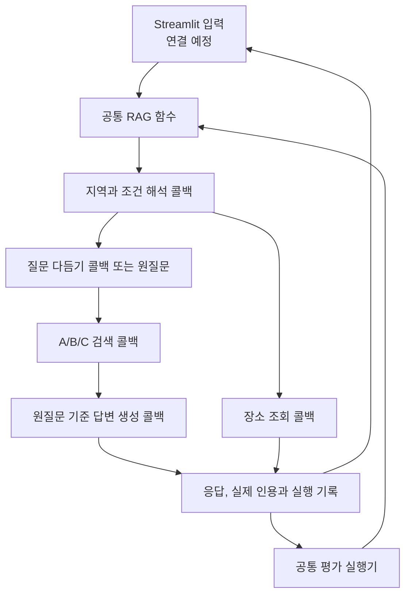

# 폴더 구조와 책임

공통 규격, 로더/청킹/로컬 색인, 파이프라인과 평가 실행기를 최소 인계 단위로 구현했다. 현재 실행 방법과 팀 함수 연결 경계는 [양석호 최소 구현 인계](seokho-handoff.md)에 있다. 아래 구조와 담당표는 팀 전체의 목표이며, 검색/생성/화면 등 각 담당자의 기능 완료를 뜻하지 않는다. 내부 파일 개수나 구현 순서는 제한하지 않는다.

## 폴더 배치

```text
.
├─ .github/                  PR, 의존성 갱신과 자동 검사
├─ .streamlit/               Streamlit 설정을 둘 위치
├─ configs/                  수집, 파이프라인과 평가 설정
├─ prompts/                  생성과 질문 다듬기의 프롬프트
├─ src/                      공통 설정, 규격, 런타임, 파이프라인과 검증
│  ├─ ingestion/             수집과 정제, 로더, 청킹과 색인
│  ├─ query/                 별칭과 질문 다듬기
│  ├─ retrieval/             A/B/C 검색, 지역 해석, 장소 저장과 조회
│  ├─ generation/            근거 기반 생성과 응답 정책
│  ├─ infrastructure/        저장소, 임베딩과 외부 자원 연결
│  ├─ interface/             Streamlit 화면, 지도와 관찰 패널
│  ├─ evaluation/            공통 실행기, 담당별 지표와 비교 분석
│  └─ observability/         실행 원본 기록과 Langfuse 연결
├─ scripts/                  합성 자동 데모, 자료 준비/근거 조회, 색인과 평가 명령, 수집 진입점
├─ data/
│  ├─ raw/                   수집 원문과 장소 원자료
│  ├─ handoff/               검토 후 Git에 포함한 실제 전처리 인계 자료
│  ├─ processed/             정제 문서, 청크와 장소 자료
│  └─ indexes/               재생성 가능한 색인
├─ eval/                     개발셋과 최종셋, 정답과 허용 근거
├─ results/                  실행별 원본과 평가 결과
├─ tests/
│  ├─ unit/                  외부 연결을 대체한 동작 검사
│  ├─ integration/           모듈과 CLI 연결 검사
│  └─ fixtures/              합성 여부를 표시한 작은 검증 자료
└─ docs/                     팀 공통 기준과 재현 문서
```

Streamlit 진입점인 루트 `app.py`와 `src/interface/`는 아직 docstring만 있는 뼈대다. Streamlit은 현재 공용 의존성에 포함되지 않았고 확인한 프로젝트 가상환경에도 설치되지 않았다. 화면 구현 시 의존성과 잠금 파일을 갱신하고, 구현된 공통 파이프라인을 호출하도록 연결한다. 현재 질문 입력은 `scripts/search_index.py`의 실제 근거 조회에서 지원하며 답변 생성과 Streamlit 화면은 연결하지 않았다. Python 패키지에는 `__init__.py`를 두었다.

## 담당 경로

| 담당 업무 | 주요 위치 | 다른 담당자와 맞출 경계 |
| --- | --- | --- |
| 데이터 수집과 질문 정제 담당자(이정은) | `src/ingestion/`의 수집과 정제, `src/query/`, 수집 설정과 별칭 자료 | 문서와 getSpot 원자료, 원질문 및 변환 질의의 인계 |
| 검색과 지역 및 장소 조회 담당자(이명지) | `src/retrieval/`, `src/evaluation/`의 검색 지표 | 지역 해석, A/B/C 후보, 장소 DB 저장과 조회, Hit@5 |
| 답변 생성과 품질 추적 담당자(강성수) | `src/generation/`, `src/evaluation/`의 Ragas 평가, `src/observability/`의 Langfuse 연결 | 응답 정책, 실제 입력과 인용, 개발문항 초안과 답변 평가 |
| 화면과 관찰 검증 담당자(이승주) | `src/interface/`, `app.py`, `.streamlit/`, 공용 검증과 비교 분석 | 지도, 상태 표시, 순위와 인용 관찰, 최종 평가셋 관리 |
| 공통 기반과 통합 담당자(양석호) | `src/` 공통 기반, `src/ingestion/`의 로더/청킹/색인, `src/infrastructure/`, 공통 평가 실행기와 원본 저장 | 호출 규격, 런타임과 버전, 전체 파이프라인과 재현 |

`src/ingestion/`, `src/evaluation/`와 `src/observability/`는 책임이 나뉜 공유 영역이다. 같은 폴더의 모든 기능을 한 담당자의 업무로 보지 않는다. 코드를 만들 때 파일별 책임을 구분하고 각 담당자의 내부 로직을 통합 코드에 복제하지 않는다.

## 파일별 구현 상태

수집/전처리와 공통 기반은 아래에 구현된 범위를 적었다. 질문 정제, 검색/지역/장소, 답변 생성과 화면/관찰 검증에는 아직 역할만 표시한 뼈대가 남아 있다. 타입은 `src/contracts.py`, 실제 함수 시그니처와 실행 방법은 [인계 문서](seokho-handoff.md)를 기준으로 한다. 담당자는 내부 파일을 확장할 수 있으며 공용 호출 경계 변경은 사용하는 담당자와 맞춘다.

### 데이터 수집과 질문 정제 (이정은)

수집/전처리는 [PR 8](https://github.com/kssk3/best-driver-rag-project/pull/8)에서 구현돼 현재 `dev`에 포함됐다. `data/handoff/jungeun/p04-2026-11-24/`의 원본과 전처리 산출물은 공통 로더에 연결했다. 다음 표의 구현 여부는 수집/전처리 코드와 질의 시점 기능을 구분한다.

| 파일 | 구현 상태와 역할 |
| --- | --- |
| `src/ingestion/collect.py` | 구현: 설정한 자치법규 본문과 첨부 목록 수집 |
| `src/ingestion/clean.py` | 구현: 본문 조문, 부칙과 제개정이유를 나눈 검토용 JSON 추출 |
| `src/ingestion/annexes.py` | 구현: 공식 첨부 HWP 수집, XML/표 셀/문단 추출과 검수 보정 반영 |
| `src/ingestion/search_preparation.py` | 구현: 병합 셀을 반영한 행 표현과 변경 이력을 남기는 제한적 용어 정규화 |
| `src/ingestion/source_review.py` | 구현: 수집 전 사람이 기록한 접근/이용조건 확인 |
| `scripts/collect.py` | 구현: 수집 실행 진입점 |
| `src/ingestion/spots.py` | 뼈대: getSpot 원자료 수집 |
| `src/query/aliases.py` | 뼈대: 품목과 표현 별칭 |
| `src/query/rewrite.py` | 뼈대: 질문 다듬기 |

공통 청커는 전처리 JSON의 원문 `text`를 사용하며 `search_text` 정규화는 아직 검색 입력에 적용하지 않는다. 새 HWP를 다시 추출하려면 `annexes.py`가 사용하는 별도 `hwp5proc` 환경이 필요하지만, 저장소 인계 자료를 읽는 준비/색인 명령에는 필요하지 않다.

### 검색과 지역 및 장소 조회 (이명지, 구현 예정)

| 파일 | 역할 |
| --- | --- |
| `src/retrieval/regions.py` | 구와 동 이름 해석 |
| `src/retrieval/search.py` | A/B/C 검색 |
| `src/retrieval/spots.py` | 장소 저장과 조회 |
| `src/evaluation/retrieval_metrics.py` | 검색 지표 |

### 답변 생성과 품질 추적 (강성수, 구현 예정)

| 파일 | 역할 |
| --- | --- |
| `src/generation/answer.py` | 근거 기반 답변과 응답 정책 |
| `src/evaluation/answer_metrics.py` | 답변 자동 평가 |
| `src/observability/tracing.py` | Langfuse 추적 |

### 화면과 관찰 검증 (이승주, 구현 예정)

| 파일 | 역할 |
| --- | --- |
| `app.py` | Streamlit 진입점 |
| `src/interface/chat.py` | 질문과 답변 화면 |
| `src/interface/map.py` | 장소 목록과 지도 |
| `src/interface/inspection.py` | 관찰 검증 패널 |
| `src/validation.py` | UI 독립 공용 검증 |
| `src/evaluation/comparison.py` | 구성 비교와 실패 분석 |

### 공통 기반과 통합 (양석호, 최소 구현)

| 파일 | 역할 |
| --- | --- |
| `src/config.py` | 명시한 JSON 설정 읽기와 실행 경로 설정 |
| `src/contracts.py` | 문서/청크, 요청/응답, 장소, 실행 기록과 평가 문항 타입 |
| `src/runtime.py` | 호출자가 준비한 팀 콜백과 기록기 연결, 실제 DB/모델 자동 생성 없음 |
| `src/pipeline.py` | 콜백 호출 순서, 생성 입력 선택, 인용 확인과 상태/오류 기록 |
| `src/ingestion/loaders.py` | 출처 목록과 본문을 갖춘 공용 문서 파일을 별도 로딩 |
| `src/ingestion/bundle_archive.py`, `preprocessed_bundle.py`, `xml_adapter.py` | 제공된 v2 묶음 검증, XML→HTML 변환과 같은 원문의 HTML/JSON 문서 쌍 연결 |
| `src/ingestion/chunking.py` | 문서 전체를 한 청크로 보존, 문자 수 초과 시 오류 |
| `src/ingestion/preprocessed_chunking.py` | v2 조문/부칙과 표 행 청킹, 머리글/병합 셀/비고 연결 |
| `src/ingestion/indexing.py` | 전달된 전체 청크의 새 색인 생성과 메모리 임베딩 캐시 |
| `src/infrastructure/embeddings.py` | 교체 가능한 provider, 데모 해시 벡터, LangChain/OpenAI 어댑터, 입력 한도 검사와 명시적 키 파일 설정 |
| `src/infrastructure/stores.py` | 로컬 JSON 색인의 검증/저장/읽기, 실제 DB 연결 없음 |
| `src/evaluation/runner.py` | 명시한 문항을 구성별로 실행하고 결과 반환, 자동 품질 지표 없음 |
| `src/observability/records.py` | 요청별 원본 JSON을 새 실행 ID로 보존, Langfuse 연결 없음 |
| `src/demo.py` | 합성 자료용 해시 검색, 명시된 구 확인과 본문 인용 생성기 |
| `scripts/demo.py` | 외부 API 없이 합성 자료의 상태별 응답을 자동 확인 |
| `scripts/prepare_data.py`, `scripts/search_index.py` | 전처리 묶음 준비/실제 색인 생성과 지역을 제한한 근거 조회 |
| `scripts/index.py` | 명시한 공용 문서의 색인 생성, HTML/JSON 형식 선택 |
| `scripts/evaluate.py` | 데모 또는 팀 연결 함수로 평가 실행, 결과 파일 저장 |

원문 수집과 HWP 전처리는 PR 8 담당 범위이며 공통 기반은 제공된 산출물을 사용한다. 실제 구조 청킹과 임베딩 색인, 근거 조회는 연결됐지만 팀 A/B/C 검색, 질문 변환 모델, 동 이름 추론, 답변 LLM, 장소 DB와 지도는 연결되지 않았다. 데모의 해시 검색과 본문 인용은 공통 흐름 확인용이며 실제 RAG 품질을 입증하지 않는다. 단위/통합 테스트와 CLI 실행 검증 결과는 [최소 구현 인계](seokho-handoff.md#구현-경계와-검증)에 기록한다.

초기 파일별 구현 항목과 플로우 차트는 [Notion 구조 문서](https://app.notion.com/p/422dc8b0e1638150b62acfe703074f30?pvs=204)에 있다. 현재 구현된 규격과 동작은 저장소 코드와 최소 구현 인계 문서를 기준으로 확인한다.

## 연결 원칙



이 도식은 팀 전체의 연결 목표다. 공통 함수와 평가 실행기는 구현됐고, 지역/검색/생성/장소 알고리즘은 담당자가 콜백으로 연결한다. 합성 CLI는 별도의 데모 콜백을 사용한다. 필요한 조건을 되묻거나 오류를 처리하는 분기는 [공통 연결 기준](TEAM-SETUP.md)을 따른다. 장소 조회와 문서 검색의 결과 형식은 분리한다.

통합 코드는 검색과 생성 모듈의 공용 호출 지점을 사용한다. 내부 파일 분리와 알고리즘 선택은 각 담당자가 정하며, 공용 입출력, 의존성, DB 구조와 실행 기록 변경은 사용하는 담당자와 맞춘다.

평가셋과 실행 결과의 관리 원칙은 [eval](../eval/README.md), [results](../results/README.md)에 둔다. `eval/`의 정답과 `results/`의 결과를 수집 자료나 검색 색인으로 사용하지 않는다.
