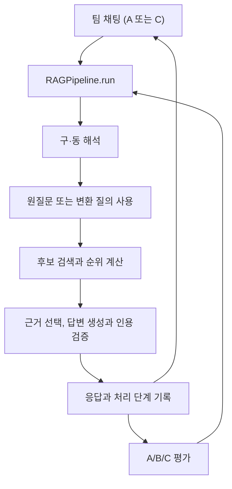

# 폴더 구조와 책임

팀 역할과 작업 단계는 [로드맵](../ROADMAP.md)에서 확인한다. 현재 구현은 `dev`를 기준으로 확인하고, 평가 결과는 [비교 보고서](../report.md)를 참고한다. 최초 공용 규격, 로컬 색인, 파이프라인은 [11월 24일 인계 기록](handoff.md)에 있다. 공용 인터페이스를 변경할 때는 아래 담당 경로를 확인한다.

## 폴더 배치

```text
.
├─ .github/                  PR, 의존성 갱신과 자동 검사
├─ .streamlit/               Streamlit 설정을 둘 위치
├─ configs/                  수집, 파이프라인과 평가 설정
├─ prompts/                  생성과 질문 다듬기의 프롬프트
├─ src/                      공통 설정, 규격, 런타임, 파이프라인과 검증
│  ├─ ingestion/             수집과 정제, 로더, 청킹과 색인
│  ├─ query/                 별칭과 질문 다듬기
│  ├─ retrieval/             A/B/C 검색과 지역 해석
│  ├─ generation/            근거 기반 생성과 응답 정책
│  ├─ infrastructure/        저장소, 임베딩과 외부 자원 연결
│  ├─ interface/             채팅, 응답 검증, 점수 비교
│  ├─ evaluation/            공통 실행기, 담당별 지표와 비교 분석
│  └─ observability/         실행 원본 기록과 Langfuse 연결
├─ scripts/                  합성 자동 데모, 자료 준비/근거 조회, 색인과 평가 명령, 수집 진입점
├─ data/
│  ├─ raw/                   수집 원문
│  ├─ handoff/               검토 후 Git에 포함한 실제 전처리 인계 자료
│  ├─ processed/             정제 문서와 청크
│  └─ indexes/               재생성 가능한 색인
├─ eval/                     개발셋과 최종셋, 정답과 허용 근거
├─ results/                  실행별 원본과 평가 결과
├─ tests/
│  ├─ unit/                  외부 연결을 대체한 동작 검사
│  ├─ integration/           모듈과 CLI 연결 검사
│  └─ fixtures/              합성 여부를 표시한 작은 검증 자료
└─ docs/                     팀 공통 기준과 재현 문서
```

[채팅 실행기](../scripts/run_chat.py)는 기본 팀 색인을 준비하거나 검증한 뒤 선택한 설정 파일 경로를 `RAG_CHAT_SETTINGS`로 [Streamlit 앱](../app.py)에 전달한다. 앱은 `create_a_catalog_runtime`으로 A 또는 C 실행 구성을 만들고, `pipeline.run(request)`의 반환값인 `RunRecord`를 [`run_record_to_view`](../src/interface/adapter.py)로 화면용 형식으로 변환한다. 첫 화면에서 질문과 자치구를 받고 결과 화면에서 답변과 근거를 표시한다. [오프라인 데모 명령](../scripts/demo.py)은 합성 자료로 `create_demo_pipeline`을 실행한다. [실행 방법](../README.md#실행-방법)

## 담당 경로

[현재 4인 역할표](../ROADMAP.md#업무-분담과-인계)의 작업을 시작할 때 확인할 파일이다. 공유 폴더는 기능별로 나누어 관리한다.

| 담당자 | 작업별 참고 파일 | 인계·검증 기준 |
| --- | --- | --- |
| 이승주 | [일반 문서 청킹](../src/ingestion/chunking.py), [전처리 자료 조문·표 청킹](../src/ingestion/preprocessed_chunking.py), [화면 진입점](../app.py), [화면 모듈](../src/interface/), [최종 평가셋](../eval/README.md) | 청킹 버전과 근거 위치 변경을 검색·답변 담당에게 공유하고, 화면에는 후보 순위와 최종 인용을 구분해 표시한다. |
| 이정은 | [수집·정제 인계](jungeun/README.md), [질문 다듬기](../src/query/rewrite.py), [프롬프트 위치](../prompts/), [질의 전달 규격](TEAM-SETUP.md#질문-지역과-답변) | 원문 근거를 교차 확인하고, 프롬프트 변경은 원질문·조건·변환 질의로 비교한다. |
| 이명지 | [지역 해석](../src/retrieval/regions.py), [팀 검색 진입점](../src/retrieval/search.py), [기존 색인 생성](../src/ingestion/indexing.py), [저장소 구현](../src/infrastructure/stores.py), [검색 평가 기준](problem.md#지표와-실패-기록) | 검색 시스템 v2에서 OpenSearch 연결을 추진한다. 청크 출처와 지역을 보존한 순위 목록을 답변 담당에게 전달한다. |
| 강성수 | [답변 정책](../src/generation/answer.py), [공통 생성 어댑터](../src/generation/pipeline_adapter.py), [답변·검색 실험](../src/evaluation/answer_experiments/), [실행 기록](../src/observability/records.py), [결과 비교](../results/testData.md) | 개발 문항의 허용 근거를 갱신하고, 실제 생성 입력과 최종 인용을 구분해 검증한다. |

공통 입출력 변경은 [계약](../src/contracts.py)과 [파이프라인](../src/pipeline.py)을 함께 확인한다. 예를 들어 청크 형식은 이승주가 변경을 주도하고 이명지·강성수가 검색과 인용에서 확인한다. 최초 구현 내역은 아래 공통 기반 인계 항목에 보존한다.

## 파일별 구현 상태

아래 표에는 담당자별 구현 상태와 후속 연결 작업을 정리했다. 지역 해석 결과가 검색에 쓰이는 방식과 생성기가 받는 입력은 [지역 해석과 답변 생성 연결](TEAM-SETUP.md#전처리-자료-지역-해석과-답변-생성-연결)에서 확인할 수 있다.

### 데이터 수집·정제와 프롬프트 개선 (이정은)

수집/전처리는 [PR 8](https://github.com/kssk3/best-driver-rag-project/pull/8)에서 구현돼 현재 `dev`에 포함됐다. `data/handoff/jungeun/ordinance-handoff-2026-11-24/`의 원본과 전처리 산출물은 공통 로더에 연결했다. 다음 표의 구현 여부는 수집/전처리 코드와 질의 시점 기능을 구분한다.

| 파일 | 구현 상태와 역할 |
| --- | --- |
| `src/ingestion/collect.py` | 구현: 설정한 자치법규 본문과 첨부 목록 수집 |
| `src/ingestion/clean.py` | 구현: 본문 조문, 부칙과 제개정이유를 나눈 검토용 JSON 추출 |
| `src/ingestion/annexes.py` | 구현: 공식 첨부 HWP 수집, XML/표 셀/문단 추출과 검수 보정 반영 |
| `src/ingestion/search_preparation.py` | 구현: 병합 셀을 반영한 행 표현과 변경 이력을 남기는 제한적 용어 정규화 |
| `src/ingestion/source_review.py` | 구현: 수집 전 사람이 기록한 접근/이용조건 확인 |
| `scripts/collect.py` | 구현: 수집 실행 진입점 |
| `src/query/aliases.py` | 품목 별칭과 공식 품목명 매핑, 단일 품목명 정규화 |
| `src/query/rewrite.py` | 원질문에 공식 품목명을 보완하고, 주입한 함수로 프롬프트 기반 질문 다듬기 콜백을 구성한다. |

공통 청커는 전처리 JSON의 원문 `text`를 사용하며 `search_text` 정규화는 아직 검색 입력에 적용하지 않는다. 새 HWP를 다시 추출하려면 `annexes.py`가 사용하는 별도 `hwp5proc` 환경이 필요하지만, 저장소 인계 자료를 읽는 준비/색인 명령에는 필요하지 않다.

### 검색과 지역 해석 (이명지)

| 파일 | 역할 |
| --- | --- |
| `src/retrieval/regions.py` | [서울 지역 기준표](../data/reference/README.md)로 구·동을 해석한다. 지역이 모호하거나 입력끼리 충돌하면 지역을 다시 물을 수 있다. |
| `src/retrieval/search.py` | 자치구로 검색 범위를 제한한다. A는 벡터 유사도로 순위를 정하고, B는 벡터와 BM25 순위를 결합한다. C는 결합한 후보를 설정된 [재정렬기](../src/retrieval/rerankers.py)에 전달한다. |
| `src/evaluation/retrieval_metrics.py` | 허용 청크 ID와 검색 후보를 대조해 Hit@k를 계산하고 집계 대상 문항을 구성별로 묶는다. |

### 답변 생성과 품질 추적 (강성수)

| 파일 | 역할 |
| --- | --- |
| `src/generation/answer.py` | 답변 가능·재질문·근거 부족·오류를 구분하고, 인용할 때 원문 출처와 문서 버전을 확인한다. |
| `src/generation/pipeline_adapter.py` | 공통 요청과 선택된 청크를 생성 입력으로 변환하고, 검증한 인용 청크 ID를 반환한다. |
| `src/evaluation/answer_experiments/` | A/B/C 평가, 품목 사전을 쓰는 채팅, 고정 근거 실험의 실행 구성을 제공한다. [평가 명령](../eval/README.md) |
| `src/evaluation/answer_metrics.py` | 실제 모델 입력으로 기록된 청크를 근거로 저장된 답변의 근거 충실도를 채점한다. |
| `src/observability/tracing.py` | 저장된 근거 충실도 점수를 Langfuse로 전송한다. [점수 업로드와 복구 방법](../results/README.md) |

### 청킹 개선과 화면·관찰 검증 (이승주)

| 파일 | 역할 |
| --- | --- |
| `src/ingestion/preprocessed_chunking.py`, `src/ingestion/chunking.py` | 인계된 청커의 후속 개선. 전처리 자료 표·비고·예외가 원문 위치와 함께 보존되는지 확인 |
| `app.py` | 첫 화면, 결과 화면과 대시보드를 표시한다. 사용자가 요청하면 Langfuse 점수를 불러온다. |
| `src/interface/chat.py` | 응답 상태, 인용 출처와 재질문 입력란을 표시한다. 일반 답변의 본문에서는 숫자 범위의 물결표가 취소선으로 해석되지 않도록 이스케이프하고, 인라인 코드와 코드 블록의 물결표는 그대로 둔다. |
| `src/interface/inspection.py` | 화면에 표시된 응답의 검증 결과와 검색 후보 순위를 보여 준다. |
| `src/validation.py` | Streamlit에 의존하지 않는 응답 검증 규칙을 제공한다. |
| `src/interface/langfuse_scores.py` | Langfuse의 네 가지 지표를 읽고 평가셋·질문 다듬기 설정·검색 방식별로 집계한다. |
| `src/interface/comparison.py` | 비교 패널에서 사용하는 A/B/C 구분과 방식별 점수 요약의 자료형을 정의한다. |

### 공통 기반의 최초 구현과 인계 (양석호)

| 파일 | 역할 |
| --- | --- |
| `src/config.py` | 명시한 JSON 설정 읽기와 실행 경로 설정 |
| `src/contracts.py` | 문서/청크, 요청/응답, 실행 기록과 평가 문항 타입 |
| `src/runtime.py` | 호출자가 준비한 팀 콜백과 기록기 연결, 실제 DB/모델 자동 생성 없음 |
| `src/pipeline.py` | 콜백 호출 순서, 생성 입력 선택, 인용 확인과 상태/오류 기록 |
| `src/ingestion/loaders.py` | 출처 목록과 본문을 갖춘 공용 문서 파일을 별도 로딩 |
| `src/ingestion/bundle_archive.py`, `preprocessed_bundle.py`, `xml_adapter.py` | 제공된 v2 묶음 검증, XML→HTML 변환과 같은 원문의 HTML/JSON 문서 쌍 연결 |
| `src/ingestion/chunking.py` | 문서 전체를 한 청크로 보존, 문자 수 초과 시 오류 |
| `src/ingestion/preprocessed_chunking.py` | v2 조문/부칙과 표 행 청킹, 머리글/병합 셀/비고 연결 |
| `src/ingestion/indexing.py` | 전달된 전체 청크의 새 색인 생성과 메모리 임베딩 캐시 |
| `src/infrastructure/embeddings.py` | 교체 가능한 provider, 데모 해시 벡터, LangChain/OpenAI 어댑터, 입력 한도 검사와 명시적 키 파일 설정 |
| `src/infrastructure/stores.py` | 로컬 JSON 색인의 검증/저장/읽기, 실제 DB 연결 없음 |
| `src/evaluation/runner.py` | 명시한 문항을 구성별로 실행하고 결과 반환, 자동 품질 지표 없음 |
| `src/evaluation/answer_quality.py`, `scripts/score_quality.py` | 정답 충족·근거 적합(판정 모델)과 근거 없음 대응(표준 안내문은 모델 없이)을 0/1로 채점해 `quality.csv` 작성 |
| `scripts/score_relevancy.py` | 저장 답변의 Answer Relevancy 사후 계산(보고서 7.6) |
| `src/ingestion/embedding_text.py`, `scripts/exp_embed_input.py`, `scripts/exp_posthoc_final.py` | 표 행 임베딩·BM25 입력 정리 실험(8장·8.1). 청크 ID·본문은 바꾸지 않고 서비스에는 적용되지 않음 |
| `src/observability/records.py` | 요청별 원본 JSON을 새 실행 ID로 보존, Langfuse 연결 없음 |
| `src/demo.py` | 합성 자료용 해시 검색, 명시된 구 확인과 본문 인용 생성기 |
| `scripts/demo.py` | 외부 API 없이 합성 자료의 상태별 응답을 자동 확인 |
| `scripts/prepare_data.py`, `scripts/search_index.py` | 전처리 묶음 준비/실제 색인 생성과 지역을 제한한 근거 조회 |
| `scripts/index.py` | 명시한 공용 문서의 색인 생성, HTML/JSON 형식 선택 |
| `scripts/evaluate.py` | 데모 또는 팀 연결 함수로 평가 실행, 결과 파일 저장 |

PR #8과 #10의 전처리 자료를 사용한다. 공용 런타임에 주입할 A 벡터 검색기와 [공용 채팅 모델 함수](../src/infrastructure/chat_models.py)가 구현됐다. 검색·생성부터 화면까지의 연결 상태는 [로드맵](../ROADMAP.md)에서 확인한다. [전처리 자료 결과표](../results/testData.md)는 별도로 수행한 로컬 비교 실험 기록이다.

초기 파일별 구현 항목과 플로우 차트는 [Notion 구조 문서](https://app.notion.com/p/422dc8b0e1638150b62acfe703074f30?pvs=204)에 있다. 현재 구현된 규격과 동작은 저장소 코드와 최소 구현 인계 문서를 기준으로 확인한다.

## 연결 원칙



팀 채팅과 평가 실행기는 같은 검색 흐름을 사용한다. 합성 데모 명령은 자체 콜백을 사용한다. 지역 재질문과 오류 처리 규칙은 [공용 연결 기준](TEAM-SETUP.md)을 참고한다.

통합 코드는 검색과 생성 모듈의 공용 호출 지점을 사용한다. 내부 파일 분리와 알고리즘 선택은 각 담당자가 정하며, 공용 입출력, 의존성, DB 구조와 실행 기록 변경은 사용하는 담당자와 맞춘다.

평가셋과 실행 결과의 관리 원칙은 [eval](../eval/README.md), [results](../results/README.md)에 둔다. `eval/`의 정답과 `results/`의 결과를 수집 자료나 검색 색인으로 사용하지 않는다.
